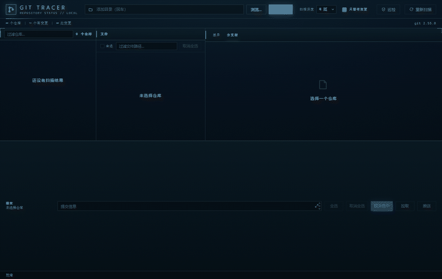
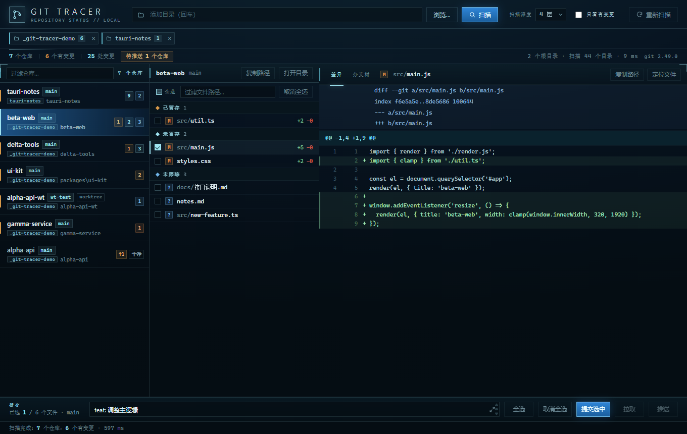
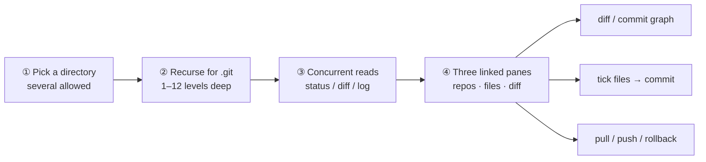
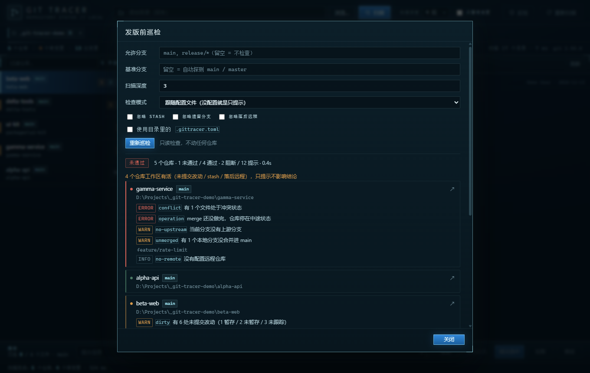
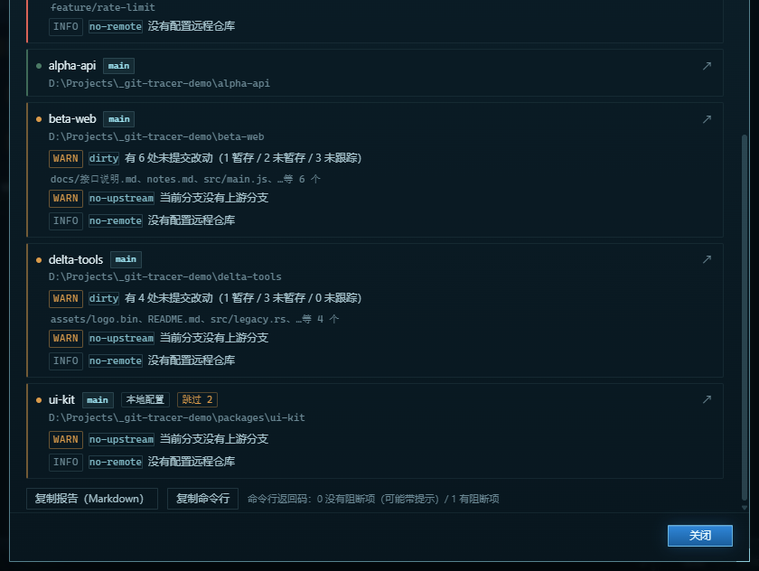

# Git Tracer

    

[中文](README.md) · **English**

Point it at a folder. It finds every Git repository underneath, puts their state on one screen, and — before you ship — audits them against a rule file that lives with your code, so the desktop app and CI return the same verdict.

> One scan, and every uncommitted file, every conflict, every unpushed commit across a pile of repos lands on the same table.

Git Tracer is a small Windows app. Give it a directory and it walks down looking for Git repositories, then shows what changed, what's conflicted, and what hasn't been pushed — all at once. Tick files to commit, push and pull in one click, browse the commit graph, or roll a branch back. Before a release, run the audit: the same fixed rule set is applied to every repo and each one gets **pass / attention / fail** with the reason. The rules can live in `.gittracer.toml` next to your code, so the GUI and CI read the same file and agree. Read-only by default; nothing is written until you press a button.



Nothing here is cut: one directory, five repositories, fourteen changes, one conflict — all on one screen. Open the audit and the two blockers (a conflict, a half-finished merge) sort first while the other repos are merely "unfinished work". **One real problem, not a wall of red.**



## The hassle it removes

A project is split across seven or eight repositories. You finish a round of changes and then you `cd` into each one and run `git status` just to be sure you didn't leave something behind. With a few more repos, you also lose track of which one has a conflict and which one has local commits you forgot to push.

Git Tracer does the walking for you: **point it at a folder (or several), and it finds every Git repository underneath**. Which files changed, how many lines added and removed, whether anything is conflicted, how many commits are unpushed — one screen. Click for the diff; tick files, type a message, commit; press push to push.

**Read-only by default, and that's deliberate.** Scanning, status, and diff only run query commands (`git status` / `git diff` / `git log`) with `--no-optional-locks`, so not even an `index.lock` is left behind. Only clicking Commit / Pull / Push / Rollback touches a repository, and committing shows a confirmation checklist first.

## Three steps

1. Unzip and double-click `GitTracer.exe` (no installer needed). To install, run `安装.cmd`.
2. Type a directory in the box and press **Enter**. You can add several roots; the `×` on a chip removes one.
3. Pick a repo on the left, files in the middle, diff on the right. To commit, tick files, write a message, press **Commit selected**.



```
┌────────────────────────────────────────────────────────────┐
│ directory box + root chips   depth   only-changed   rescan  │
│ 7 repos · 6 with changes · 25 changes · 1 to push           │
├──────────────┬──────────────────┬──────────────────────────┤
│ repo list    │ file list        │ diff / commit graph      │
│ branch, ↑↓   │ ticks, groups    │ line numbers, +/− colour │
├──────────────┴──────────────────┴──────────────────────────┤
│ message ______  [all] [none] [commit] [pull] [push]         │
└────────────────────────────────────────────────────────────┘
```

The palette is dashboard/terminal: dark blue-black, thin cyan lines, blue selection, amber warnings. Information density over decoration.

## What it does

### Every repository on one screen

- **Recursive scan**: finds `.git` at any depth (1–12 levels, default 4). It skips noise directories — `node_modules`, `target`, `dist`, `.venv`, `vendor` — and refuses to follow junctions or symlinks, so it never crawls an entire drive.
- **Multiple roots at once**: add as many as you like; results merge into one list. A repo covered by two roots appears once and is tagged with its root.
- **Nested repos included**: it keeps descending after finding a repo, so submodules and repos inside a monorepo are not missed.
- **States kept apart**: staged / unstaged / untracked are separate groups, and a file changed in both shows up in both. Conflicted files sort first with a `U`. Clean repos are still listed (dimmed) unless you hide them.
- **Real diffs**: unified text diff with line numbers and add/remove colouring, plus explicit handling of binaries and oversized files.

### Commit, push, pull without leaving the app

- Tick the files you want. The backend runs `git add -A -- <paths>` then `git commit -m <message> -- <paths>`, so **something already staged elsewhere isn't dragged in, and unticked files are untouched**.
- `Ctrl+Shift+E` opens a large editor when the message needs to be long.
- Pull is `git pull --no-edit`, and it tells you which happened: fast-forwarded, already up to date, merged, or rebased. The button shows `↓N` when you're behind and is disabled when there's nothing sensible to pull.
- Push runs `git push`, or `git push -u` when there's no upstream; the button shows `↑N`. Failures come back as a plain-language hint (credentials, conflicts, non-fast-forward). There's also a **to-push panel** listing exactly which repositories still have commits unpushed — push one, several, or all (failures stay put, the rest continue).

### A commit graph that stays readable

- Lanes, forks, and merges are computed in the frontend and drawn as SVG from `git log --all --date-order`, last 300 commits. Each row carries the short hash, ref badges (`HEAD` green, local branch cyan, `origin/…` purple, tag amber), subject, author, and date.
- Click a commit to see its patch. Search matches subject, author, branch/tag, hash, and date, using subsequence matching with scoring — so `fgsr` finds `feature/graph-search`. Hits are highlighted, `Enter` opens the first one, `Esc` clears.
- **Rollback to any commit**: opening a commit's diff offers "roll back to here", which first runs a read-only check — where the branch would move from and to, how many commits are dropped, how many uncommitted changes are in the way — and then lets you choose **mixed** (changes stay in the working tree, default), **soft** (changes stay staged), or **hard** (committed changes are discarded; extra confirmation required). Dropped commits survive in the reflog; untracked files are never deleted.

### It remembers

Root directories, scan depth, filter toggles, and the active tab are stored locally and restored next time.

## Audit before you ship

Click **Audit** in the top right. It doesn't ask what changed; it answers one question: **can these repositories be released right now?**

Every repo gets the same rules, and each finding says which rule fired:

| Group | Rule | Severity | Fires when |
| --- | --- | --- | --- |
| Release state | `conflict` | blocker | a file is still in conflict |
| | `operation` | blocker | merge / rebase / cherry-pick / revert / bisect is left half-done |
| | `detached` | blocker | HEAD is not on any branch |
| | `unpushed` | blocker | commits were not pushed to the upstream |
| | `branch` | blocker | current branch is not in the allow list (`main`, `release/*`, …) |
| | `read-error` | blocker | repository state cannot be read (unreadable dir / git error); cannot be skipped |
| Working copy | `dirty` | warning | uncommitted changes (staged / unstaged / untracked counted separately) |
| | `behind` | warning | behind the remote |
| | `stash` | warning | stash entries left behind |
| | `unmerged` | warning | local branches not merged into the base branch |
| | `no-upstream` | warning | current branch has no upstream |
| | `no-remote` | info | no remote configured |

The verdict has three states: **pass** (no blockers, no warnings), **attention** (no blockers, but unfinished work in the working copy), **fail** (blockers).

### Why `dirty` is a warning, not a blocker

It used to be a blocker. The first run on a real developer machine came back **entirely red**: every repository the person had touched recently was "failed", sometimes over a single modified `package-lock.json`. At that point "failed" meant "you have worked in this repo", and the report carried no information — **all red is the same as no red**.

So the two questions are now separate. If the *release state* is wrong, that's a blocker (ship it and you have an incident). If the *working copy* has unfinished work, that's a warning, because uncommitted work is what writing code looks like — it isn't a release defect. The report still has a dedicated section listing which repositories have unfinished work, so it can go into a release ticket.

**If you build releases straight from the working tree**, `dirty` really is a risk for you (the artifact won't correspond to any commit). Turn strict mode on to promote it back to a blocker:

- GUI: set **Check mode** to "strict"
- CLI: `gittracer-audit . --strict`
- Rule file: `strict = true` in `.gittracer.toml`

Results are grouped into "needs attention" first and "passed" after, with rule name and file count for each finding. Two buttons at the bottom: **copy report (Markdown)** to paste into a release ticket, and **copy command** to wire into CI.



One thing happens in the background: **it runs in parallel**. `git status` is a process call; a repo with `node_modules` takes a second or two, and a few dozen of them in series is ninety seconds — nobody waits for that before a release. The audit fans out across CPU cores (up to 8 workers): 268 repositories in ~90 s, a few dozen in seconds. All read-only.

### Command line

`gittracer-audit.exe` ships in the same zip — a console program, no window:

```sh
gittracer-audit --root D:\work --branch "main,release/*" --base main
```

Exit codes: `0` no blockers (warnings allowed), `1` blockers found, `2` bad arguments or paths. So in CI:

```yaml
- run: gittracer-audit --root . --branch "main,release/*" --fail-on error
```

`--format text|md|json`, `--out report.md`, `--skip stash,unmerged`, `--strict`, `--no-config` are supported; `gittracer-audit --help` lists everything. Like the GUI it is read-only: no fetch, no refs written, no working-tree changes.

## Put the rules in the repository

Command-line flags and GUI inputs only live for one run. On another machine, for another person, in CI, they're gone. Written into `.gittracer.toml`, the rules travel with the repository and everyone gets the same verdict:

```toml
# .gittracer.toml
depth = 3                      # only meaningful in the root-level file
branch = ["main", "release/*"]
base = "main"
skip = ["behind", "stash"]
strict = true                  # building from the working tree? uncommitted changes block
```

Two locations, outside in:

| Where | What it governs |
| --- | --- |
| `<root>/.gittracer.toml` | every repository under that directory; also sets `depth` (1–16) |
| `<repo>/.gittracer.toml` | that one repository. `depth` has no effect there (it only means "how deep to search from a root"); the report says so and the rest still applies |

Precedence: **explicit CLI / GUI values > repo file > root file > built-in defaults**. "Not written" and "written empty" are different things: omitting `branch` inherits the outer layer, while `branch = []` means "don't check branches at all". `skip` is a union, widening outward; an empty array in a file never cancels a `--skip` from the command line.

A few deliberate decisions:

- **A broken root-level file is an error** (exit code 2, with file name and position). It governs the whole run; silently ignoring a misspelled key means "you thought it was enforced, it wasn't" — as dangerous as a false pass.
- **A broken repo-level file fails only that repository.** Everything else still reports; that repo gets a `config-error` finding carrying the original message. One bad file must not cost the whole report — that's the same as not auditing at all.
- **A repository may relax the rules locally, but the report says so.** `--format md` tags it "based on repo config" plus the skipped rules; JSON carries `config` / `effective_skip`. A gate may accept your explanation; it may not quietly let things through.
- **`--no-config` (the checkbox in the GUI) turns the whole file mechanism off**, useful for "is this the config or the environment?".
- **A missing root is never silently skipped.** A typo in CI would otherwise produce "empty report, verdict pass". Instead the usable roots are audited, the unusable ones are printed at the top of the report, the verdict is fail, and the exit code is 1.
- **Commit the config file itself.** It's a normal file; uncommitted, it counts as `dirty` — "1 uncommitted change (.gittracer.toml)" on first run is a reminder, not a bug.



## In CI

The repo ships a ready-made workflow, [`.github/workflows/audit.yml`](.github/workflows/audit.yml): it runs when you push a `v*` tag, and can be started manually with your own roots, branch allow-list and skips. Other repositories can reuse it:

```yaml
jobs:
  audit:
    uses: haoguan2013/gittracer/.github/workflows/audit.yml@v0.8.0
    with:
      roots: '.'
      branch: 'main,release/*'
```

It builds `gittracer-audit` itself, so it doesn't depend on a published package; the report goes to the job summary and an artifact, and a non-zero exit fails the job. Leave inputs empty and it reads `.gittracer.toml` from the repo: `depth`, allowed branches, base, skips, strict — the workflow only runs it. (`@v0.8.0` assumes the tag exists; use `@main` before that.) If you'd rather not compile Rust in CI, swap the build step for the published zip:

```yaml
- run: |
    gh release download --repo haoguan2013/gittracer --pattern "GitTracer-*-portable.zip" --dir pkg
    Expand-Archive (Get-ChildItem pkg/*.zip).FullName -DestinationPath pkg/bin
  env:
    GH_TOKEN: ${{ github.token }}
```

Two traps worth knowing:

- **Check out the full history** (`fetch-depth: 0`). A shallow clone has no remote-tracking branches, so `ahead` / `behind` / `branch --no-merged` all read as 0 and the checks silently degrade to "everything passes" — more dangerous than failing to run.
- A tag build checks out a detached HEAD, so the workflow passes `--skip detached` by default. Drop that if you run on branches and want detached HEAD to be caught.

## How it differs from other multi-repo tools

There are plenty of these. Decide which job you need first:

- **Just want a glance at who's dirty and who's behind**: terminal aggregators (`gfold`, `gv`, …) are lighter and finish in milliseconds. They don't answer "can we ship".
- **Want hunk staging, interactive rebase, a graphical conflict editor**: use a full single-repo Git client. Git Tracer deliberately doesn't do those.
- **Want "can this batch of repositories be released" to be a reproducible verdict**: that's the one thing it focuses on — rules travel with the code, GUI and CLI share one implementation, the report can be filed with the release.

In other words: it isn't trying to be a faster `git status`, or a more complete Git client. It's the per-repository check you run once, before shipping.

## Keyboard shortcuts

| Key | Action |
| --- | --- |
| `Enter` (directory box) | add a root and scan |
| `F5` / `Ctrl+R` | rescan |
| `↑` / `↓` | move between repos / files |
| `Space` | tick / untick the current file |
| `Ctrl+Enter` | commit the ticked files |
| `Ctrl+Shift+E` | open the large multi-line message editor |
| `Ctrl+F` (commit graph) | focus the commit search box |
| `Enter` / `Esc` (search) | open the first hit / clear |
| `/` | focus the repo filter |

## Safety boundary

One sentence: **reading is free, writing needs your click.**

| Action | Writes to a repo? |
| --- | --- |
| Scan, status, diff, commit graph, search, pre-rollback check | No (read-only commands + `--no-optional-locks`) |
| Commit selected, pull, push, rollback | Yes, and each needs a button press or confirmation |

Hard rules underneath: empty commit messages are rejected; **commits and diff previews accept only repo-relative paths** (absolute paths, `..`, drive letters are refused, so previews can't read files outside the repo); pushes are never forced; credentials must be configured up front (`GIT_TERMINAL_PROMPT=0`, the app never shows a login prompt); git subprocesses do not inherit `GIT_DIR` / `GIT_WORK_TREE` / `GIT_INDEX_FILE`, so a stray shell variable can't redirect them at another repository; the UI runs under a CSP (`script-src 'self'`) and everything derived from repository content is escaped.

## Download and install

Grab `GitTracer-0.8.0-portable.zip` from **Releases** (no binaries are committed to the repo; you can also build it yourself):

| Option | How | Notes |
| --- | --- | --- |
| Portable | unzip, run `GitTracer.exe` | writes nothing outside its folder |
| Install | run `安装.cmd` | copies to `%LOCALAPPDATA%\Programs\GitTracer`, adds Start Menu / desktop shortcuts and an uninstall entry |
| Uninstall | `卸载.cmd`, or Settings → Apps | — |

Why a zip instead of an `.exe` installer: an NSIS installer must unpack itself into `%TEMP%` at startup, which fails wherever the temp directory isn't writable. A "copy files + create shortcuts" script never touches `%TEMP%`. The full investigation is in [docs/DEV_NOTES.md](docs/DEV_NOTES.md) (Chinese).

## Build from source

Requires **Windows 10/11 + Git for Windows** (on `PATH`), **Node 18+ / pnpm**, **Rust (MSVC toolchain)**, and **WebView2** (bundled with Win10/11 in practice).

```powershell
pnpm install        # only @tauri-apps/cli
pnpm dev            # dev mode; editing dist/ needs no rebuild
pnpm tauri build    # release exe + NSIS installer
```

To produce the portable zip:

```powershell
powershell -NoProfile -ExecutionPolicy Bypass -File tools\make-package.ps1
```

Artifacts: `src-tauri/target/release/git-tracer.exe`, `gittracer-audit.exe` beside it, and `GitTracer-0.8.0-portable.zip`. `tools/` also holds `make-demo-data.ps1` (fake repositories for testing and screenshots), `make-icons.py` (stdlib only), `cdp.mjs` (drives the UI over CDP for screenshots), and the two-step GIF recorder: `make-gif.mjs` captures frames, `gif.py` assembles them (`pip install pillow` for that step).

### Layout

```
dist/                  frontend: index.html + styles.css + app.js, no bundler
src-tauri/src/
  main.rs              GUI entry point
  bin/audit.rs         CLI entry point (gittracer-audit.exe)
  lib.rs               Tauri builder and the async commands
  audit.rs             audit rules, report rendering, exit codes (read-only, no Tauri)
  config.rs            .gittracer.toml parsing, validation, layering
  git.rs               runs git, parses porcelain v2 / numstat / diff / log
  scan.rs              directory walk looking for .git
  dialog.rs            folder picker, reveal in Explorer
.gittracer.toml        this repo's own rules — a working example of the format
tools/                 packaging, install, demo data, icons, CDP debugging
.github/workflows/     the pre-release audit workflow
docs/                  screenshots + dev notes + release notes
```

The stack is deliberately boring: a Rust backend that runs git and parses output, and three plain frontend files talking to it through Tauri's `invoke`. **No React/Vue, no build step** — clone it and you can read the whole thing. The audit lives in `audit.rs`, which doesn't depend on Tauri, so the GUI and the CLI share one implementation.

<details>
<summary>Command surface (for people modifying the code)</summary>

| Command | Arguments | Returns |
| --- | --- | --- |
| `git_info` | — | whether git is available, version, path |
| `scan_repos` | `root, depth, limit?` | repo list, directories scanned, elapsed |
| `repo_status` | `path` | branch, upstream, ahead/behind, stashes, entries[] |
| `file_diff` | `path, file, staged, untracked` | unified / text / binary / empty / too_large |
| `repo_graph` / `commit_diff` | `path, limit?` / `path, hash` | commit graph, patch of one commit |
| `commit_files` / `push_repo` / `pull_repo` | see source | results of commit, push, pull |
| `reset_plan` / `reset_repo` | `path, hash[, mode]` | read-only check / perform rollback |
| `audit_repos` | `roots[], depth?, branch[], base?, skip[], useConfig?, strict?` | audit report + Markdown + equivalent command line |
| `pick_folder` / `reveal_path` | `initial?` / `path` | system dialog, reveal in Explorer |

Every git call uses `--no-optional-locks`, `core.quotepath=false`, `GIT_TERMINAL_PROMPT=0`. Timeouts: 60 s per repo status, 30 s per file diff, 2 MiB diff preview cap, 5 min per push/pull.

</details>

## Boundaries, stated up front

- **Windows only**: the folder picker uses PowerShell + WinForms and the console hiding is Windows-specific.
- **No live refresh**: press `F5` after changing things on disk; the app doesn't watch the filesystem.
- **Commits don't span repositories**: one commit covers the ticked files of the current repo, no `--amend`, no hunk selection.
- **Push covers the current branch only**: no force, no tags, no branching/merging/tagging.
- **The commit graph is read-only**: up to 300 commits. "Rollback" is `git reset`, not `git revert` (no inverse commit is created); dropped commits are only in the reflog.
- **Credentials must be configured up front**: git fails instead of prompting, so set up a credential manager or SSH key first.
- **The audit doesn't fetch**: "behind the remote" uses the local remote-tracking value. Run `git fetch --all` first if you need it exact.
- **The audit doesn't fix anything**: it only reports (pass / attention / fail). No auto-commit, no auto-push, no `--fix`. Fix it back in the UI.
- **Config can only relax, not tighten**: `skip` is a union across layers, so a repo-level file can't re-enable a rule the root file already skipped. Missing a blocker is worse than an extra one, so the outer layer wins.

Full release history, local build gotchas, and `GIT_TRACER_DATA_DIR` live in [docs/DEV_NOTES.md](docs/DEV_NOTES.md); this release is described in [docs/RELEASE_NOTES.md](docs/RELEASE_NOTES.md). Issues and PRs welcome.

## License

Apache-2.0. See [LICENSE](LICENSE).
