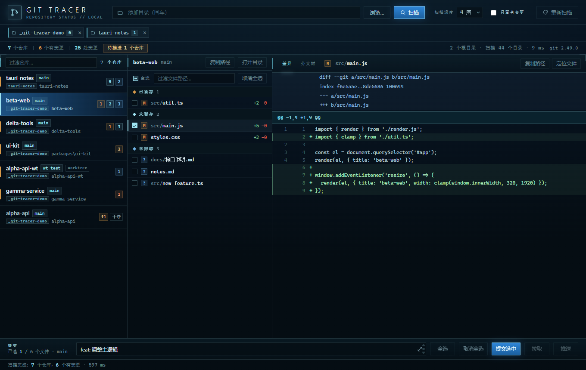
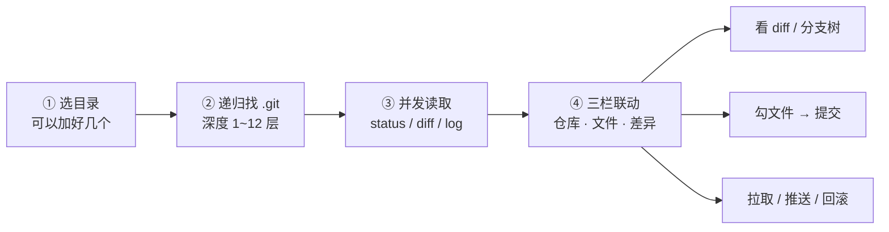
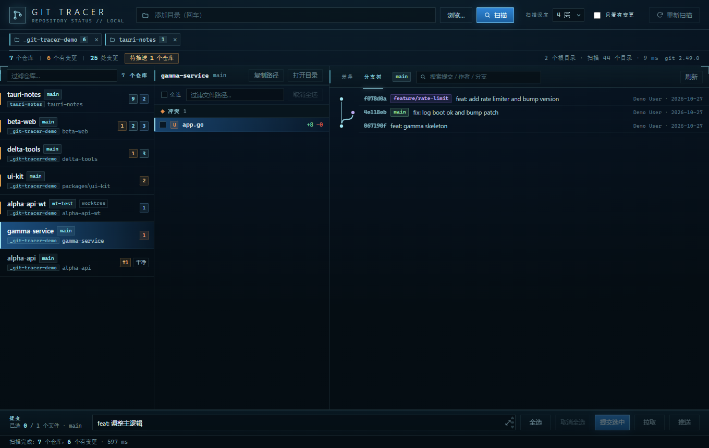
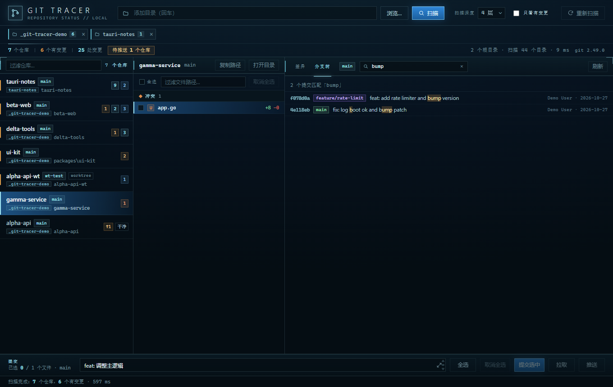
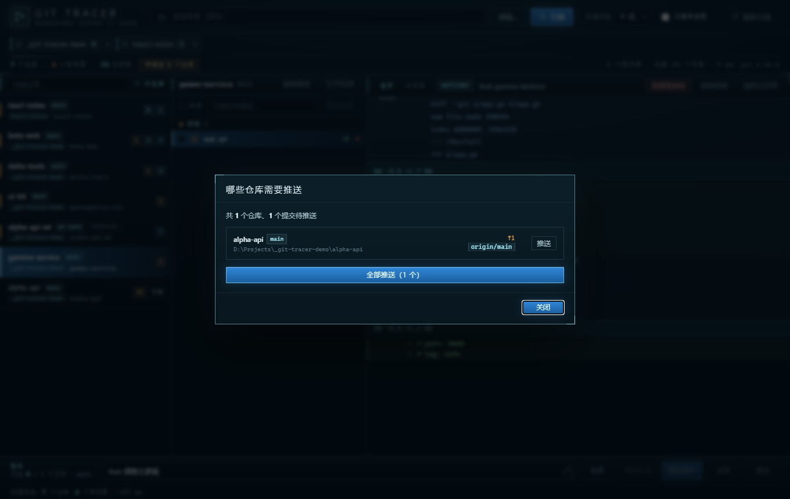
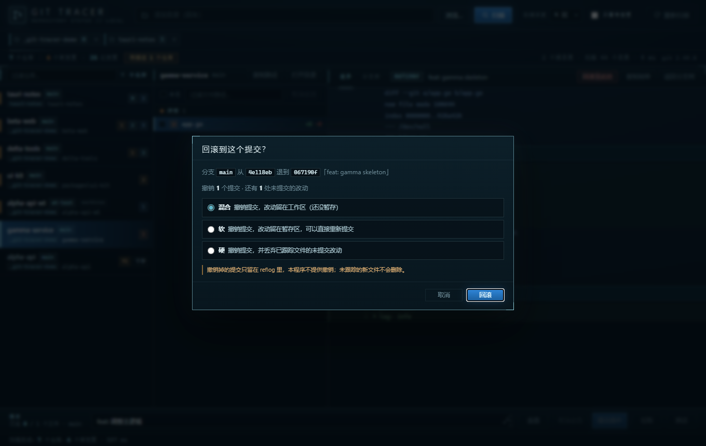

# Git Tracer

   

> 一次扫描，把一堆仓库里没提交的、冲突的、还没推的东西，全摆到一张桌上。

Git Tracer 是款 Windows 小工具：给它一个目录，自动找出所有 Git 仓库，把待提交改动、冲突和未推送提交汇总到一屏；支持勾选提交、一键推拉、分支树与回滚。默认只读，点按钮才写仓库。



## 它解决什么麻烦

一个项目拆成七八个仓库，改完一圈，你得挨个 `cd` 进去敲 `git status`，才敢确定自己没落下什么。仓库再多一点，还会忘了哪个有冲突、哪个本地提交忘了推。

Git Tracer 就是替你跑腿的：**给它一个文件夹（或者好几个），它自己往下翻，把所有 Git 仓库找出来**，谁改了哪些文件、加了几行删了几行、有没有冲突、有几个提交没推，一屏全给你。看 diff 点一下就行；要提交就勾几个文件写句话；要推就点一下「推送」。

**默认只读，这点先说清楚。** 扫描、看状态、看 diff 全程只跑 `git status` / `git diff` / `git log` 这类查询命令，还统一带了 `--no-optional-locks`，连 `index.lock` 都不会留下。只有你亲手点「提交」「拉取」「推送」「回滚」时才会动仓库 —— 而且提交前会弹一次确认清单。

## 三步上手

1. 解压后双击 `GitTracer.exe`（不用安装）；想装到开始菜单就双击 `安装.cmd`。
2. 顶部输入框填一个目录，按 **Enter**，可以连续加多个根目录，标签上的 `×` 移除。
3. 左边点仓库 → 中间看文件 → 右边看 diff；要提交就勾文件、写信息、点「提交选中」。



界面就三栏，没有隐藏菜单：

```
┌────────────────────────────────────────────────────────────┐
│ 目录输入 + 根目录标签   扫描深度   只看有变更   重新扫描    │
│ 7 个仓库 · 6 个有变更 · 25 处变更 · 待推送 1 个仓库         │
├──────────────┬──────────────────┬──────────────────────────┤
│ 仓库列表      │ 文件列表          │ 差异 / 分支树            │
│ 分支、↑↓ 数   │ 勾选框、分组      │ 行号 + 增删着色          │
├──────────────┴──────────────────┴──────────────────────────┤
│ 提交信息 ______  [全选] [取消全选] [提交选中] [拉取] [推送] │
└────────────────────────────────────────────────────────────┘
```

配色走的是仪表盘 / 终端那一挂：深蓝黑底、细青色线、蓝色选中条、琥珀色警示，信息密度优先。

## 它能做什么

### 一屏看全所有仓库

- **递归扫描**：从任意根目录往下找 `.git`，深度 1~12 层可调（默认 4）。自动跳过 `node_modules`、`target`、`dist`、`.venv`、`vendor` 这些噪音目录，也绕开 junction / 符号链接，不会一头爬进整个盘。
- **多个根目录一起看**：加几个目录都行，结果合并成一个列表，同一个仓库被两个根覆盖时只出现一次，行上标出它属于哪个根。
- **嵌套仓库也找得到**：发现仓库后还会继续往里下钻，子模块和 monorepo 里的仓库不会漏。
- **分得清状态**：已暂存 / 未暂存 / 未跟踪各占一组，同一个文件两边都改了就两组都出现；冲突文件排最前并标 `U`；干净的仓库也列出来（灰一点），勾「只看有变更」才藏起来。
- **不会卡**：扫描完先出仓库列表，状态由并发任务逐个回填，状态栏显示「已读 / 总数」。

### 改了什么，看得明明白白

- **Diff 预览**：行号、`+/-` 着色、hunk 头；未跟踪文件直接读内容全绿显示；二进制和超大文件给提示而不是硬塞给你。
- **合并冲突**：用 `git diff` 的 combined diff 原样渲染，`<<<<<<<` / `=======` / `>>>>>>>` 标记保留在正文里。
- **中文路径**：所有 git 命令带 `core.quotepath=false`，`docs/接口说明.md` 就是原样显示，不会变成一串八进制。
- **增删行数**：文件名右侧的 `+12 -3` 来自 `git diff --numstat`。



- **分支树**：右侧切到「分支树」标签，用 `git log --all --date-order` 取最近 300 个提交，前端自己算车道、用 SVG 画分叉和合并。行上有短哈希、ref 徽标（`HEAD` 绿、本地分支青、`origin/…` 紫、tag 琥珀）、标题、作者和日期。点一行就在「差异」标签里看这个提交的补丁。
- **搜索提交**：边打边筛，匹配标题、作者、分支 / 标签、哈希、日期；用的是「子序列 + 打分」，所以 `fgsr` 也能命中 `feature/graph-search`，多个词用空格分开且都要命中。命中的字高亮，回车打开第一个结果，`Esc` 清空。



### 该动手时也不磨叽

- **只提交你勾的文件**：文件列表每行有勾选框，顶上和底部都有「全选 / 取消全选」。后端先把勾中的路径 `git add -A -- <路径>`，再 `git commit -m <信息> -- <路径>` —— **别处已经暂存的内容不会被顺手带走，没勾的文件不会被动**。
- **提交信息随便长**：底部输入框固定高度，要写多行点右边的 `⤢` 开大文本框（`Ctrl+Shift+E`），里面 `Ctrl+Enter` 直接提交。
- **拉取**：`git pull --no-edit`，落后几个提交按钮上就显示 `↓N`；拉完告诉你「已快进 / 已是最新 / 已合并 / 已变基」。没远程、detached HEAD、还没提交过时按钮直接禁用，不让你白点。
- **推送**：有上游就 `git push`，没上游自动 `git push -u`；按钮上的 `↑N` 是待推提交数。失败按 git 的原话给中文提示（凭据、冲突、non-fast-forward 等）。
- **待推送面板**：统计条上点「待推送 N 个仓库」，能看到**具体哪几个仓库**没推、各差几个、推到哪个上游，可以逐个推，也能一次全推（失败的留在原地，其余照常继续）。



- **回滚到任意提交**：从分支树打开某个提交的差异后，点「回滚至此处」会先做一次只读体检 —— 当前分支从哪个提交退到哪个、会撤销几个提交、还有几处未提交改动 —— 再让你选**混合**（改动留工作区，默认）、**软**（改动留暂存区）或**硬**（丢弃已跟踪文件的未提交改动，需额外勾选确认）。撤销掉的提交只留在 reflog 里，未跟踪的新文件不会被删。



- **记得住**：根目录列表、扫描深度、过滤开关、当前标签页都存在本地，下次打开还在。

## 常用快捷键

| 按键 | 作用 |
| --- | --- |
| `Enter`（目录框） | 加一个根目录并扫描 |
| `F5` / `Ctrl+R` | 重新扫描 |
| `↑` / `↓` | 在列表里切换仓库 / 文件 |
| `空格` | 勾选 / 取消当前文件 |
| `Ctrl+Enter` | 提交选中的文件 |
| `Ctrl+Shift+E` | 打开大文本框写多行提交信息 |
| `Ctrl+F`（分支树） | 聚焦提交搜索框 |
| `Enter` / `Esc`（搜索框） | 打开第一个结果 / 清空搜索 |
| `/` | 聚焦仓库过滤框 |

## 安全边界

一句话概括：**读随便读，写要你点头。**

| 动作 | 会不会写仓库 |
| --- | --- |
| 扫描、看状态、看 diff、看分支树、搜索、回滚前的体检 | 不会（只读命令 + `--no-optional-locks`） |
| 提交选中、拉取、推送、回滚 | 会，且都要你点按钮或过确认框 |

另外三条硬规则：提交信息为空直接拒绝；只接受仓库内的相对路径（绝对路径、`..`、盘符都拒）；推送不做 force，凭据要提前在命令行配好（`GIT_TERMINAL_PROMPT=0`，程序不会替你弹登录框）。

## 下载与安装

到本仓库的 **Releases** 页面下载 `GitTracer-0.5.0-portable.zip`（仓库里不放二进制包，也可以按下面的命令自己生成）：

| 方式 | 做法 | 说明 |
| --- | --- | --- |
| 免安装 | 解压后双击 `GitTracer.exe` | 不写系统目录，拷走就能用 |
| 装到本机 | 双击 `安装.cmd` | 复制到 `%LOCALAPPDATA%\Programs\GitTracer`，建开始菜单 / 桌面快捷方式，写卸载项 |
| 卸载 | 双击 `卸载.cmd`，或「设置 → 应用」 | — |

为什么给的是 zip 而不是 `.exe` 安装包：NSIS 安装器启动时一定要往 `%TEMP%` 解压自己的数据，在临时目录不可写的环境里必然失败；换成「复制文件 + 建快捷方式」的脚本后，全程不碰 `%TEMP%`。完整排查记录见 [开发与排障笔记](docs/DEV_NOTES.md)。

## 从源码跑起来

需要 **Windows 10/11 + Git for Windows**（在 PATH 里）、**Node 18+ / pnpm**、**Rust（MSVC toolchain）**、**WebView2**（Win10/11 一般自带）。

```powershell
pnpm install        # 只装 @tauri-apps/cli
pnpm dev            # 开发模式，改 dist/ 里的前端不用重新打包
pnpm tauri build    # release exe + NSIS 安装包
```

生成上面那个便携 zip：

```powershell
powershell -NoProfile -ExecutionPolicy Bypass -File tools\make-package.ps1
```

产物在 `src-tauri/target/release/git-tracer.exe` 和 `GitTracer-0.5.0-portable.zip`。`tools/` 里还有生成测试仓库的 `make-demo-data.ps1`、生成图标的 `make-icons.py`（纯标准库）、以及用 CDP 驱动界面截图的 `cdp.mjs`。

### 项目怎么搭的

```
dist/                 前端：index.html + styles.css + app.js，没有打包器，直接改
src-tauri/src/
  main.rs             入口
  lib.rs              Tauri Builder 与 13 个 async 命令
  git.rs              跑 git 命令、解析 porcelain v2 / numstat / diff / log
  scan.rs             目录遍历找 .git
  dialog.rs           文件夹选择、资源管理器定位
tools/                打包、安装、造测试数据、图标、CDP 调试
docs/                 截图 + 开发排障笔记
```

技术选型很朴素：Rust 后端只负责跑 git 和解析输出，前端是三个原生文件，通过 Tauri 的 `invoke` 调后端。**没有 React/Vue，也没有构建步骤**，clone 下来就能读懂全貌。

<details>
<summary>后端命令接口（给想改代码的人）</summary>

| 命令 | 参数 | 返回 |
| --- | --- | --- |
| `git_info` | — | git 是否可用、版本、路径 |
| `scan_repos` | `root, depth, limit?` | 仓库列表、扫描目录数、耗时 |
| `repo_status` | `path` | 分支、上游、ahead/behind、stashes、entries[] |
| `file_diff` | `path, file, staged, untracked` | unified / text / binary / empty / too_large |
| `repo_graph` / `commit_diff` | `path, limit?` / `path, hash` | 提交图、某个提交的补丁 |
| `commit_files` / `push_repo` / `pull_repo` | 见源码 | 提交、推、拉的结果 |
| `reset_plan` / `reset_repo` | `path, hash[, mode]` | 只读取体检 / 执行回滚 |
| `pick_folder` / `reveal_path` | `initial?` / `path` | 系统对话框、定位文件 |

所有 git 调用统一带 `--no-optional-locks`、`core.quotepath=false`、`GIT_TERMINAL_PROMPT=0`。单仓库 status 超时 60 s，单文件 diff 30 s，diff 预览上限 2 MiB，push / pull 5 分钟。

</details>

## 几个边界，先讲在前面

- **只支持 Windows**：文件夹选择走 PowerShell + WinForms，隐藏控制台也是 Windows 专用。
- **不会自动刷新**：改完磁盘上的内容按 `F5`，程序不监听文件系统事件。
- **提交不跨仓库**：一次只提交当前仓库里勾中的文件，不做 `--amend`，也不能按 hunk 挑改动。
- **推送只推当前分支**：不 force，不推 tag，不切分支、不合并、不打 tag。
- **分支树只读**：最多 300 个提交；「回滚」是 `git reset`，不是 `git revert`（不会生成反向提交），撤销的提交得自己去 reflog 捞。
- **凭据要提前配好**：需要交互式输入用户名密码时 git 会直接报错，请先配好凭据管理器或 SSH key。

完整版本记录、本机构建踩坑、`GIT_TRACER_DATA_DIR` 等环境变量说明，都在 [docs/DEV_NOTES.md](docs/DEV_NOTES.md)。有想法或遇到问题，欢迎提 Issue / PR。
